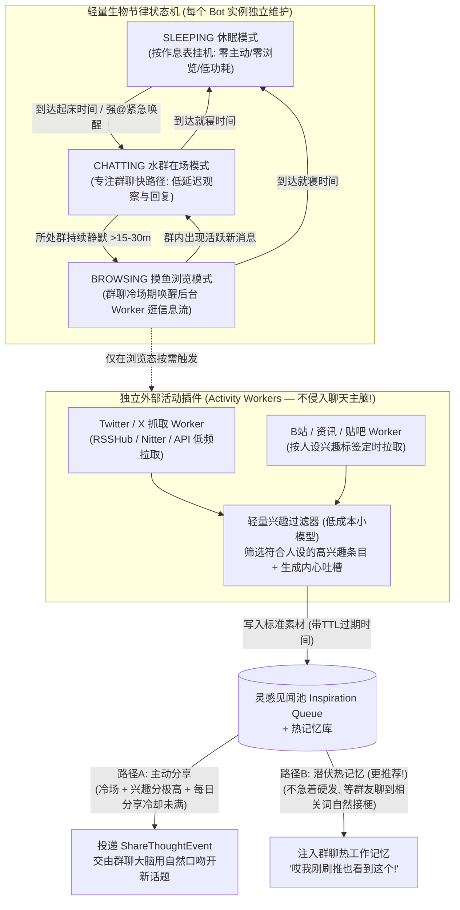
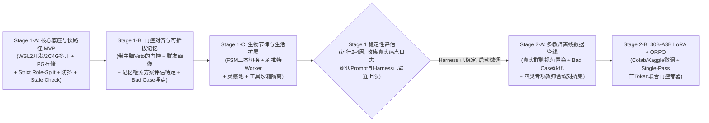

# 01｜Kairos（知时）项目总览、竞品调研与架构愿景

> **文档定位**：本系列文档共 3 篇，用于指导高拟真 QQ 群聊 LLM Bot 系统从 0 到 1 落地：
> - **本文（01 总览）**：命名与产品定位、现有生态与前沿调研、五大痛点治理边界、模式扩展与工具化核心架构权衡、Stage 1~2 总路线图。
> - **[02_Kairos_Stage1_技术栈与2C4G工程实现规划.md](./02_Kairos_Stage1_技术栈与2C4G工程实现规划.md)**：聚焦 **Stage 1（零微调 Harness）**，针对 **2C4G 服务器托管 1~3 个 Bot** 的低内存架构、协议选型、数据流与工程落地细节。
> - **[03_Kairos_Stage2_30B微调与多教师蒸馏方案.md](./03_Kairos_Stage2_30B微调与多教师蒸馏方案.md)**：待 Stage 1 Harness 稳定后启动的 **Stage 2**，基于《星布谷地》多教师蒸馏思路的 30B MoE LoRA 数据管线与 Colab/Kaggle 训练方案。

---

## 一、 项目命名与核心定位

### 1.1 命名方案：**Kairos（中文：知时）**

* **命名寓意**：在古希腊哲学中，时间分为两种——**Chronos** 代表机械流逝的钟表时间，而 **Kairos** 代表**“恰到好处的时机”**。
* **为什么契合本项目**：一个具备“强活人感”的群聊 Bot，其核心壁垒从来不是“知识有多渊博”，而是**知时机、懂进退**——能感知群聊的时间流与话题切换，知道何时该插话接梗、何时该贴个表情、何时该安静潜水、何时该自己去刷推特摸鱼、深夜该按点休眠。
* *（备选风格名供参考：偏日常轻快可用 **Mingle / 冒泡**；偏社交氛围感可用 **Atmos / 气场**；偏节律作息感可用 **Tide / 潮汐**。系列文档统一采用 **Kairos** 作为框架与项目代号。）*

### 1.2 核心定位

* **首要目标**：打造**“强活人感的在场群友（Social Presence Agent）”**——有独立人格、有作息节律、懂群聊上下文拓扑、能读空气、能带外部生活见闻（如刷推特/看热点）自然融入群聊。
* **扩展与兼容目标**：同一套底层引擎支持在 **2C4G 轻量服务器**上稳定托管 **1~3 个独立 Bot 实例**，既可运行强活人感群友，也可通过配置切换出纯工具型/半工具型实例。
* **实施原则**：**Harness 工程先行（Stage 1），效果稳定后再微调（Stage 2）**。优先用极低成本的系统工程解决 75%~85% 的群聊痛点，并利用 Stage 1 线上真实运行日志沉淀高质量语料与 Bad Cases，为 Stage 2 精准微调铺路。

---

## 二、 现有生态与前沿方案调研

### 2.1 开源 QQ LLM Bot 生态对比

当前 NTQQ 时代底层协议已收敛至 **OneBot v11/v12**（主流实现为 **NapCat**、**Lagrange.Core**、**LLOneBot**），核心差异集中在编排与记忆层：

| 代表项目 | 核心机制与亮点 | 解决痛点的尝试 | 仍存在的局限与借鉴点 |
| :--- | :--- | :--- | :--- |
| **MaiBot（麦麦 / MaiCore）** | **心流系统（HeartFlow / SubHeartflow）** 后台持续观察 + 时机门控（Timing Gate） + `A_Memorix` 图谱/向量记忆 + 多段短消息/错别字/表情包表达 | 目前开源社区“活人感”最突出的范式；摆脱了死板关键词触发，引入群印象与精力值概念 | 多阶段 LLM 调用链路偏重，高并发群聊时延迟与成本攀升；依赖 MongoDB 等组件，对 2C4G 多开不太友好 |
| **AstrBot** | 模块化 Pipeline + Event Bus；内置与社区插件（Proactive Chat / HeartFlow）支持**双模型架构**（轻量模型打分 + 主模型回复）+ 按群异步锁 | 工程化清晰，滑动窗口缓存上下文、防并发限流做得成熟 | 多数实现仍将群聊拼接为单一 `user` 文本流，易导致模型分不清自己上轮说的话；缺乏时间衰减与线程级 DAG 建模 |
| **LangBot（原 QChatGPT）** | **事件驱动智能体（EBA）** + 多管道 + MCP / Dify / RAG 工作流编排 | 强在工具调用、知识库问答、群事件自动化 | 偏向“任务型工具机器人”，原生缺乏社交氛围感知与去 AI 味设计 |
| **WeClone** | 聊天记录导出清洗（同人连发合并窗口、QA 配对窗口、LLM-as-a-Judge 过滤）+ LLaMA-Factory LoRA 微调 | 验证了通过清洗真实聊天记录微调出个人网感与口癖的可行性 | 强依赖 1v1 私聊；直接用未做拓扑重建的群聊微调极易导致人格分裂和指代错乱 |

### 2.2 工业界前沿参考：米哈游《星布谷地》AI NPC 架构

在 2026 云栖大会上，米哈游《星布谷地》AI 总负责人李嫣然公开了其高活人感 NPC 的底层设计，直接对应本项目的 Stage 1 与 Stage 2：

1. **类脑“前额叶”认知中枢（对应 Stage 1 Harness）**：模仿人脑前额叶统一处理杂乱的多源外部信号，在“一对多”复杂社交场景下完成注意力分配、社交氛围判断与话题优先级排序，决定“此刻优先回应谁、回哪个话题”。
2. **多教师在线蒸馏（对应 Stage 2 LoRA 演进）**：后台维护多个专项教师模型（人设一致性、逻辑严密性、情感共情、安全边界），将多维约束平衡蒸馏进**同一个轻量统一模型**中，从而在推理期避免跑又慢又重的串行 Agent Loop。
3. **跨会话长期记忆**：将零碎对话沉淀为结构化的实体偏好与事件记忆，而非暴力堆砌历史文本。

### 2.3 学术界多方对话（Multi-Party Dialogue）关键结论

* **《Speak or Stay Silent》（Purdue / Ishiki Labs）**：证实零样本 LLM 无法稳定胜任多方对话的 Turn-Taking（何时说/何时闭嘴），最典型失效是**“第三人称陷阱”**——群友只是在**议论** Bot（Mentioned），而非**呼唤** Bot（Addressed），通用模型常误触发抢答。
* **《SA-LLM》（Contrastive Speaker-Aware Learning）**：指出多说话人交错导致张冠李戴的根源是标准注意力缺乏说话人边界对比信号，显式 Speaker-Attributed 编码可显著缓解。
* **《Jarvis》**：有效的主动群聊介入需要结构化触发信号（直接寻址、知识缺口/事实纠错、情绪/兴趣共振），而非盲目概率掷骰子。

---

## 三、 五大核心痛点与“Harness vs. LoRA”治理边界

| 核心痛点 | 本质根因 | Stage 1：Harness 工程解法（低成本解决比例） | Stage 2：30B LoRA 攻坚部分 |
| :--- | :--- | :--- | :--- |
| **1. 分不清用户（张冠李戴）** | ChatML 仅三角色；群名片长且易变；同人连发碎消息割裂注意力 | **解决 ~70%**：稳定短 ID 映射（`[U1:阿明]`）+ 同人短时连发聚合 + 活跃成员速查表 + 显式 `reply_to` 建边 | **最后 ~30%**：超长上下文下多人辩论的底层指代注意力固化 |
| **2. 分不清自己上轮说的话 / 复读 / 缺乏主体性** | **格式错位**（把 Bot 历史发言塞进 `user` 气泡）+ **本体错位**（“扮演某人”而非“第一人称在场”） | **解决 ~60%**：**Strict Role-Split 协议**（Bot 历史发言严格作为原生 `assistant` turn）+ 语义防复读护栏 + 客户端第一人称 Prompt | **最后 ~40%（微调最高收益点）**：洗去原生 `assistant` 的客服腔/端水 RLHF 先验，建立稳固第一人称主体性 |
| **3. 时间坐标上的话题感知与非线性交织** | 群聊是多线程 DAG；LLM 对绝对时间差算术不敏感；缺少冷却信号 | **解决 ~85%+（纯工程主战场）**：**相对时间衰减标签**（`[-15m]` / `[-4s]`）+ 静默断层分隔符 + 活跃线程板 + 过期回复强制带 QQ 引用 | **辅助 ~15%**：将时间衰减与线程切换直觉内化进模型参数 |
| **4. 自主发言门控（何时说/何时闭嘴）** | 概率/关键词无法读空气；零样本存在“第三人称陷阱”和抢答倾向 | **解决 ~55%**：规则冷却/精力预算 + 极快小模型结构化打分 + 动作空间扩展（加入 `REACT` 贴表情/复读+1） | **核心 ~45%**：通过大量真实沉默样本与第三人称负样本内化精准门控直觉 |
| **5. 复杂 Agent Loop 导致延迟并与痛点 3 叠加** | 多步串行推理耗时 5~15s，发出时话题早已翻篇 | **解决 ~80%**：自适应防抖聚合 + **后台异步记忆预热**（主路径零 RAG 阻塞）+ **发送前过期校验（Stale Check：补引用或吞咽丢弃）** | **关键 ~20%**：30B-A3B MoE（3B 激活）+ **Single-Pass 首 Token 联合门控**，合并“决策+回复”为单次前向 |

---

## 四、 关键架构权衡专题（回应核心设计难题）

### 4.1 专题一：如何扩展“刷推特 / 休眠 / 多模式”，同时防止 Agent 臃肿复杂？

如果在聊天主脑里不断塞入“刷推特工具、看 B 站工具、写日程工具、发群消息工具”，系统会迅速膨胀成一个**巨型 ReAct 怪兽**：Prompt 极长、延迟爆炸、Token 暴涨、且模式之间互相干扰。

**Kairos 的核心破局原则：把“生活活动”从聊天主脑剥离，采用“轻量生物节律状态机（FSM）+ 异步事件生产者（Activity Workers）+ 灵感收件箱（Inspiration Queue）”的彻底解耦架构。**

#### 架构图逐层讲解

1. **为什么“不臃肿”？—— 严格的“生产者-消费者”单向边界**
   * **Activity Workers（刷推特、逛 B 站等）根本不是主 Agent 的 Tool**！它们是完全独立的低频异步脚本/定时任务，拥有自己独立的抓取逻辑和极简筛选 Prompt。
   * 它们唯一的输出，是往数据库的 `Inspiration Queue`（灵感见闻池）里塞一条标准 JSON（标题、摘要、原链接、人设内心吐槽、兴趣分 `0~10`、过期时间 `TTL=6h`）。
   * **聊天主脑完全不知道也不需要关心推特 API 怎么调、反爬怎么绕**，聊天主脑的 System Prompt 永远保持短小精悍，扩展 10 个外部社交平台也不会增加主脑 1 个 token 的负担！
2. **两种“刷推分享”路径，杜绝变成“营销号转发机器人”**
   * **路径 A（极低频主动分享）**：只有当一条见闻兴趣分极高（如 $\ge 8.5$）、且该群处于冷场状态、且满足**“每日每群最多主动分享 1~2 次”的硬冷却锁**时，才触发一次主动发群（“草，刚才刷推看到个离谱的东西……”）。
   * **路径 B（潜伏式记忆融合——活人感天花板）**：80% 刷到的有意思内容**不立刻发群**，而是静静躺在 Bot 的短期见闻记忆里。几个小时后，只要群里恰好有人提到了相关游戏/科技/梗，后台热记忆检索把它捞出来，Bot 就能极其自然地接一句：“*哎我也刚在推上刷到这个，评论区老外都在喷……*”。这比定时播报新闻的活人感高出几个维度。
3. **三态生物节律状态机（FSM）兼顾活人感与省钱省算力**
   * **`SLEEPING` 休眠态**：例如设定凌晨 01:30 ~ 08:30（每天加 $\pm 20$ 分钟随机抖动，避免像闹钟一样死板）。休眠期关闭后台浏览与主动门控，**零 Token 消耗、CPU 归零**；仅在被连续 `@` 时以极低概率回一句带困意的短句。
   * **`CHATTING` 在场水群态**：一旦有群进入热聊，FSM 立刻切入在场态，把有限的 2C4G CPU 和 API 并发全留给低延迟聊天快路径，暂停刷推等重 IO 任务。
   * **`BROWSING` 摸鱼浏览态**：所有活跃群都安静下来超过一定时间，自动切入低频浏览，模拟真人“群里没人说话就切出去刷会儿手机”的行为闭环。

---

### 4.2 专题二：“纯工具型 Agent 是强活人感群友的阉割版吗？”

你的直觉**抓住了底层共性（对了一大半），但工程架构上有一个必须规避的陷阱**。

* **为什么看起来像“阉割版”？**
  在**社交存在层（Presence & Trigger Layer）**上，纯工具型 Bot 确实可以看作强活人感群友关闭了多项开关后的退化形态：
  * 关闭主动门控 -> 改为确定性触发（仅 `@` 或 `/` 指令）；
  * 关闭生物节律与休眠 -> 改为 24 小时随叫随到；
  * 关闭分段防抖、情绪精力值与过期吞咽 -> 改为有问必答。
* **但为什么工程上不能直接当“纯阉割版”混在一起跑？**
  因为两者的**核心优化目标与上下文形态存在冲突**：

| 对比维度 | 强活人感群友（Social Presence） | 纯工具型助手（Task / Utility） |
| :--- | :--- | :--- |
| **第一优化目标** | **Precision & Vibe（宁可闭嘴不破坏气氛，低延迟、高自然度）** | **Recall & Accuracy（必须答对、步骤完整，可容忍 10~30s 延迟）** |
| **上下文洁净度** | 极度怕污染！一旦历史里充斥 JSON、长篇分析、工具报错，立刻退化成“AI 客服腔” | 需要保留结构化工具返回、多步中间推理与完整参数 |
| **执行范式** | 单步/快慢双脑，无显式长循环 | 多步 ReAct / Function Calling 循环 |

* **Kairos 的统一解法：`Unified Core` + `BotProfile 配置驱动` + `工具子协程沙箱（Ephemeral Tool Sub-Context）`**
  1. **底层完全复用同一套引擎**：协议接入、多实例调度、消息总线、存储、LLM 路由 100% 共享。
  2. **上层通过 `BotProfile` 声明形态**：你在 2C4G 服务器上托管 3 个 Bot 时，可以轻松配置 2 个 `profile: social_companion`（强活人感群友）+ 1 个 `profile: utility_assistant`（关闭心流/休眠，开启全量工具链的纯工具助手）。
  3. **群友偶发查资料走“沙箱子协程”**：当强活人感群友偶尔需要执行工具（例如群友问“帮我查下今天 Steam 夏促几点开始”）时，**绝不在聊天主历史里塞 Function Calling 报文**，而是拉起一个临时的无状态 Tool Sub-Runner 跑完搜索拿到纯文本事实，再由主脑用群友口吻总结回复（并附带 `reply_to` 引用原提问）。主聊天上下文永远干干净净！

---

## 五、 两阶段演进路线图（Stage 1 -> Stage 2）

### 阶段目标划分

* **Stage 1（当前唯一聚焦：高上限 Harness 工程落地）**：
  * 在本机 **WSL2** 完整开发（与已有 NapCat 同环境对齐），最终部署至 **2C4G + 原生 PostgreSQL** 稳定托管 1~3 个 Bot 实例；
  * 用纯工程手段把张冠李戴、复读、回复过期旧话题、抢话，以及**异构门控-主脑对齐漂移**（见文档 02 详述）压到极低水平；
  * 记忆系统底层检索策略（是否引入 Embedding 向量检索）暂标为**待定**，先以可插拔接口与结构化记忆/关键词召回跑通；
  * 落地三态生物节律与首个生活扩展插件（刷推特/RSS 见闻融入），并在 PostgreSQL 无感沉淀决策日志与 Bad Cases，为 Stage 2 攒出黄金原材料。
* **Stage 2（Harness 稳定后再启动：30B MoE 多教师蒸馏 LoRA）**：
  * 以 `Qwen3-30B-A3B-Instruct-2507`（仅 3.3B 激活参数，兼顾 30B 智商与 3B 极速）为基座；
  * 落地“类星布谷地”多教师离线合成 + Rollout ORPO 纠偏；
  * 将 Stage 1 的“独立小模型门控 + 主模型生成”升级为 **Single-Pass 首 Token 联合门控**，彻底消灭最后 15%~20% 的“AI 味、第三人称误触发、双倍延迟”。
