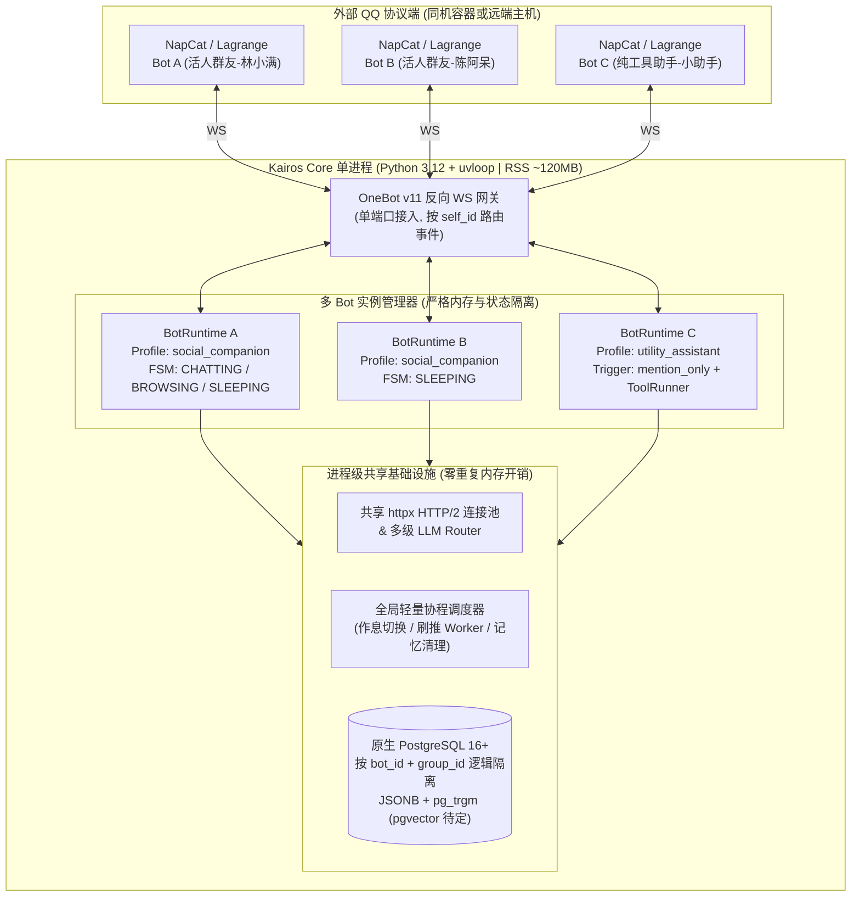
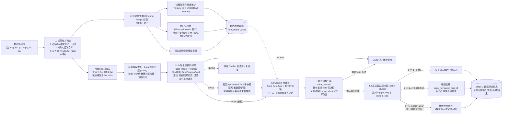

# 02｜Kairos Stage 1：技术栈选型与 2C4G 多 Bot 工程实现规划

> **文档聚焦**：本文专注于 **Stage 1（零微调 Harness 阶段）** 的具体工程设计与代码级规划，核心硬约束为：**在 2 核 4G（2C4G）轻量服务器上，稳定、低延迟、低内存地同时托管 1~3 个 QQ Bot 实例**，并预留生活扩展插件（如刷推特）与 Stage 2 数据埋点接口。

---

## 一、 2C4G 硬件约束与内存硬核预算（避坑首要前提）

在 2C4G（2 vCPU / 4096 MB RAM）机器上跑 1~3 个 QQ Bot，**CPU 通常不是瓶颈（因为模型推理都在云端 API，核心逻辑是纯 IO 密集型），内存才是唯一的生死线！**

### 1.1 最大的内存陷阱：QQ 协议端选型

很多人做架构只算了 Python Bot 内存，上线才发现服务器被 **QQ 协议端**直接打 OOM：

| 协议端方案 | 单账号常驻内存 | 托管 3 个账号总内存 | 稳定性与优缺点 | 2C4G 部署建议 |
| :--- | :--- | :--- | :--- | :--- |
| **NapCat（基于 LinuxQQ / NTQQ）** | **~500 ~ 850 MB**（含 Electron/NT 内核） | **~1.8 ~ 2.5 GB** | 协议最全、抗风控最稳、社区最活跃；但吃内存极凶 | 2C4G 同机运行建议**上限 2 个 NapCat**；若必须跑 3 个，需开启 **2GB~4GB zram/Swap** 并严格限制 Docker `--memory`，或将协议端放在本地旧电脑/闲置机，2C4G 只跑 Kairos Core |
| **Lagrange.Core（C# 无头纯协议）** | **~80 ~ 150 MB** | **~300 ~ 450 MB** | 纯无头实现，内存省 5~6 倍，2C4G 轻松多开 3~5 个 | 签名服务依赖外部 Sign Server，需持续关注腾讯风控更新；适合内存极度吃紧的场景 |

### 1.2 2C4G 绝对红线与内存分配预算表

> [!CAUTION]
> **2C4G 严禁部署以下重型组件**：
> - ❌ **严禁本机跑 PyTorch / SentenceTransformers 本地 Embedding 模型**（单个 BGE-M3 常驻内存 1.2GB~2GB，直接爆机）。
> - ❌ **严禁安装 MongoDB + Redis + Milvus 三件套**（空载即可吃掉 1GB+ RAM）。
> - ✅ **采用原生 PostgreSQL（经 2C4G 内存精调）+ 单进程内热缓存**，兼顾多 Bot 高并发持久化、事务安全与极低内存占用。

**目标内存分配预算（以 2C4G 原生安装 PostgreSQL + 托管 1~3 个 Bot 为例）：**

| 进程 / 组件 | 预期常驻内存（RSS） | 说明与优化手段 |
| :--- | :--- | :--- |
| Linux OS + 基础服务 | ~300 ~ 400 MB | 原生部署减少容器底座额外开销 |
| **PostgreSQL（原生安装，2C4G 精调）** | **~80 ~ 180 MB** | 关键配置：`shared_buffers=128MB`、`work_mem=4MB`、`maintenance_work_mem=64MB`、`max_connections=30` |
| **Kairos Core（单进程托管 1~3 个 Bot）** | **~100 ~ 180 MB** | Python 3.12 + `uvloop` 单进程多协程，共享代码段与 `asyncpg` / `httpx` 连接池 |
| 协议层（方案 A：3×Lagrange） | ~350 ~ 450 MB | 总物理占用 ~1.0~1.2 GB，余量极其充裕 |
| 协议层（方案 B：2~3×NapCat） | ~1.5 ~ 2.4 GB | 配合 2GB zram + 2GB Swap 兜底，总物理占用控制在 ~3.2 GB 内（或仅本机 WSL 跑 NapCat 反向连云服务器） |

---

## 二、 开发环境与 Stage 1 技术栈选型

### 2.1 本机开发位置规划：全面放在 WSL2 内开发

鉴于本机 NapCat 已安装在 WSL 中，且线上目标是 2C4G 原生 Linux 服务器，**后续完整开发直接放在 WSL2 内部是最优解**：

* **与 NapCat 零障碍直连**：Kairos Core 与 NapCat 同处 WSL 网络栈，直接 `127.0.0.1` 反向 WebSocket 通信，彻底绕开 Windows <-> WSL 跨网卡端口转发和防火墙折腾。
* **与生产服务器 100% 运行时一致**：
  * Windows 原生不支持 `uvloop`，而 WSL2 可直接跑生产同款 `Python 3.12 + uvloop`；
  * WSL2 内可直接原生安装与生产一致的 **PostgreSQL**（通过 `systemd` 管理），本地调试 SQL/索引/连接池与上线无缝迁移。
* **唯一硬性避坑规范**：项目代码与本地数据目录**必须放在 WSL2 内部 Linux 文件系统**（例如 `~/projects/kairos`），**严禁放在 `/mnt/c/...` 下**（Windows 挂载盘的跨系统 IO 极慢，会导致热重载卡顿、Git 极慢以及文件权限错乱）。用 IDE（如 Antigravity / VS Code）的 Remote-WSL 模式直接连接 `~/projects/kairos` 即可获得原生丝滑体验。

### 2.2 运行时语言：Python 3.12 Asyncio（单进程多租户）vs. Go

| 维度 | **Python 3.12 + `asyncio` + `uvloop`（Stage 1 推荐）** | Go（架构完全定型后的备选） |
| :--- | :--- | :--- |
| **内存占用（3 Bot）** | **~100 ~ 180 MB**（远低于 4G 预算红线） | ~25 ~ 50 MB |
| **IO 并发性能** | 极高（QQ 群聊日均几千~几万条消息对 `uvloop` 几乎零压力，CPU 占用 <5%） | 极高 |
| **开发与迭代效率** | **极快**——Stage 1 需要高频调整 Prompt 模板、滑动窗口算法、刷推抓取插件、以及无缝对接 Stage 2 数据清洗与评测脚本 | 中等，调优 Prompt/实验脚本略繁琐 |

**结论**：Stage 1 首选 **Python 3.12 (`uvloop`) 单进程多实例架构**，在 2C4G 上性能和内存完全过剩，同时换取最快的 Harness 迭代效率。

### 2.3 完整核心技术栈清单

* **核心运行时**：`Python 3.12` + `uvloop` + `pydantic v2`（强类型配置与消息 Schema，Rust 内核解析极快）
* **通信与协议层**：`aiohttp` / `websockets`（作为 **OneBot v11 反向 WebSocket Server**，多个 NapCat/Lagrange 实例主动连入，自动按 `self_id` 路由到对应 Bot 实例，无需给每个 Bot 开独立服务端口）
* **数据库与持久层（原生 PostgreSQL）**：
  * **PostgreSQL 16+（原生安装）**：相比 SQLite，在多 Bot 并发写入 + 后台慢脑异步更新 + 审计埋点查询下无写锁竞争；原生支持 **`JSONB`**（存上下文快照、话题标签）、**`pg_trgm` / GIN 索引**（免 Embedding 即可实现高质量中文关键词与模糊召回），且后续如需扩展向量或图谱，可直接原地开启扩展，无需迁移数据库。
  * **Python 异步驱动**：`asyncpg`（性能最高、内存极省的 PG 异步驱动，配合轻量 `alembic` 管理表结构演进）。
* **LLM 路由层**：`httpx`（全异步共享 `AsyncClient` 连接池，复用 HTTP/2 连接降低握手延迟），采用标准 OpenAI 兼容协议，内部配置**三级模型路由**：
  * `gate_model`（极速初筛门控）：优先选与主模型**同家族**的极快小模型（如 `Qwen3-Flash/8B` 配 `Qwen3-Max/30B-A3B`，或 `Gemini Flash-Lite` 配 `Gemini Flash/Pro`），目标耗时 `< 400ms`；
  * `chat_model`（主力群聊）：高情商强网感模型，且拥有**最终沉默否决权（Veto）**；
  * `worker_model`（后台慢脑）：廉价模型，负责异步记忆摘要提炼、话题归纳、推特筛选。
* **记忆检索策略（【待定 / TBD】）**：
  * **暂不急于绑定 Embedding 向量方案**（原因详见 3.3 节）。Stage 1 将记忆层抽象为可插拔的 `MemoryProvider` 接口，初期先用 **PostgreSQL 结构化画像 + 近期事件摘要 + `pg_trgm` 关键词召回** 跑通零 Embedding 基线，后续再对比评估是否引入 `pgvector` Embedding、层级摘要或轻量实体图谱。
* **轻量管理面板（可选）**：`FastAPI` 挂载在同一事件循环内，提供极简 JSON/WebUI 状态页（查看 1~3 个 Bot 的 FSM 状态、精力值、一键标记 Bad Case）。
* **部署与依赖管理**：`uv`（极速虚拟环境与依赖锁）+ `systemd`（原生守护进程，比 Docker 更省 2C4G 内存）+ 结构化日志 `structlog`（按天轮转）。

---

## 三、 核心系统架构设计与图解

### 3.1 架构图一：单进程多 Bot 托管架构（Multi-Tenant Runtime）



#### 图一架构讲解
1. **为什么用“反向 WebSocket 单端口接入”？**
   无论 1 个还是 3 个协议端（本地 WSL 调试或协议端与云服务器分离部署），全部主动向 Kairos Core 的单一 WS 端口（如 `/onebot/v11/ws`）发起连接并携带 `X-Self-ID` 头。网关层根据 `self_id` 将事件精准分发给对应的 `BotRuntime`，彻底解耦网络拓扑。
2. **多 Bot 严格隔离 vs. 基础设施共享**：
   * **完全隔离的部分**：每个 `BotRuntime` 拥有独立的 `BotProfile`（人设、作息、门控阈值）、独立的按群分组的 `GroupSession`（`dict[(bot_id, group_id), GroupSession]`）、独立的群级 `asyncio.Lock` 防并发锁、以及 PostgreSQL 里的 `bot_id` 分区，**杜绝串人设、串记忆、串冷却**。
   * **共享的部分**：1~3 个 Bot 共享同一个 Python 进程、同一个 `httpx` 长连接池、同一组 `asyncpg` 数据库连接池（如 `min_size=2, max_size=10`）和后台协程调度器，这是把 Core 进程内存死死压在 **150MB 以内**的关键！
3. **同群防互相死循环（多 Bot 进同一个群的必踩坑）**：
   如果 Bot A 和 Bot B 都在同一个群，网关层会自动维护已知的 `hosted_bot_ids` 集合：Bot A 收到 Bot B 的消息时，对其标记 `is_peer_bot=True` 并施加额外的**“Bot 互聊衰减系数”**（最多连续互相接 2 轮即强制冷却），防止两个 AI 在群里无限互相捧哏刷屏烧干 API 余额！

---

### 3.2 架构图二：单群“快慢双脑”消息处理流水线（核心 Harness）

这是解决五大痛点（张冠李戴、复读、时间话题漂移、自主门控、低延迟）的核心心脏：



#### 图二流水线逐节点讲解（每一处都直击痛点）

1. **L0 规范化与聚合（治痛点 1 开头）**
   * **稳定短 ID**：内存中维护每个群的 `uid_to_alias` LRU 映射（如把 QQ `123456789` 映射为 `U1`，附上清洗后限长 6 字的昵称 `U1:阿明`），过滤掉火星文和长头衔噪声。
   * **同人连发合并（Burst Coalescing）**：若 `U1` 在 10 秒内连发 3 条短消息且中间无人插话，合并为一条记录（用 ` / ` 连接，保留首尾 `msg_id`），极大节省 Token 并防止注意力碎片化。
   * **环形缓冲区（Ring Buffer）**：每群内存仅保留最近 `40` 条原始结构化消息（约占用几十 KB），更早的消息全在 PostgreSQL 磁盘里。
2. **后台异步慢脑（治痛点 3 & 5 的核心解耦）**
   * **零阻塞预热**：主聊天路径**永远不在等回复的瞬间去同步查记忆库**！后台低优先级协程每当收到 5~8 条消息或检测到关键词/新话题时，异步调用可插拔 `MemoryProvider`，把相关的近期事件摘要、群友画像、刷推见闻（`Inspiration Queue` 潜伏内容）提前写进内存里的 `HotContext Cache`。主路径直接零延迟读取！
3. **自适应防抖 + 两级门控（治痛点 4 & 5）**
   * **防抖**：防止在别人打字连发半句话时抢话；被直接 `@` 时缩短至 `0.5s` 保证秒回手感。
   * **L1-a 规则门控（<1ms）**：检查 FSM 是否在 `SLEEPING`、该群精力值是否耗尽、是否在最短发言间隔冷却期内（如刚说完 3 秒内非被 `@` 不连续刷屏）。
   * **L1-b 轻量初筛门控（`gate_model`, <400ms）**：只喂给极快小模型**最近 12 条消息 + 线程状态 + 精简 `GatePersonaCard`**（总计 <600 tokens），开启 JSON Mode，只吐极短字段：
     ```json
     {"action": "pass", "candidate_target": "m108", "need_skill": null, "reason": "群友提及Bot感兴趣的显卡话题"}
     ```
     特别加入 `REACT` 动作（调 OneBot `set_msg_emoji_like` 给消息贴个点赞/笑哭表情）——成本极低、不打断对话流、活人感极强！
4. **L2 Context 组装器：Strict Role-Split + 相对时间轴（根治痛点 1、2、3）**
   * **Strict Role-Split**：遍历 RingBuffer，把 Bot 自己之前真正发出去的消息**严格拆成原生的 `assistant` message**；把两次 Bot 发言之间所有群友的消息打包成 `user` message。这样模型绝不会把自己上轮说的话当成别人说的，也不会顺口复读。
   * **动态相对时间轴**：组装瞬间实时计算 `now - msg.ts`，标注为 `[-18m]`、`[-2m]`、`[-6s]`；相邻两条消息时间差 $> 5$ 分钟时强制插入 `--- [静默 X 分钟] ---` 分隔行。
   * **主脑 Veto + 发送前防复读**：主模型如判定不适合发言可直接输出 `<|act:silent|>` 否决门控；送出前对新生成文本和 Bot 最近 2 条发言做轻量字符/二元组相似度检查（Jaccard > 0.7 直接拦截重写或丢弃）。
5. **L3 发送前过期校验 Stale Check（治痛点 3 + 5 叠加社死）**
   * 推理前记录 `trigger_seq`，推理完成后立刻读群里最新 `current_seq` 计算增量 $\Delta$：
     * $\Delta \le 1$：原样发出（支持把模型输出的 `||` 拆成 1~2 条短消息，中间按字数 `sleep(0.6 ~ 1.5s)` 模拟真人敲字）。
     * $2 \le \Delta \le 5$：自动补齐 QQ 原生引用回复 `[CQ:reply,id=...]` 指向 `target_msg_id`，告诉全群“我在回上面那条”，瞬间化解插楼尴尬。
     * $\Delta > 5$ 或最新话题已彻底切换：直接静默吞咽丢弃本次回复，把刚才消耗的 Token 当沉没成本，**绝不为了省几厘钱发一条过时社死消息！**

---

### 3.3 深度专题：异构双模型门控的“对齐问题”与记忆检索待定策略

#### 一、采用不同模型作为门控是否会导致对齐问题？—— **会！必须用工程机制兜底**

当 `gate_model`（轻量小模型）和 `chat_model`（强主模型）不是同一个模型时，确实会出现**“左右脑分裂（Gate-Chat Misalignment）”**，典型表现为：
1. **虚假激活导致尬聊**：小模型误以为有梗可接并放行，主模型看完整上下文却觉得没话可说，但被强迫必须回复，只能硬憋出一句充满 AI 味的端水话（“哈哈确实如此呢”）。
2. **人设话痨度割裂**：主模型是“高冷惜字如金”人设，而通用小模型默认偏“热情积极”，导致频繁放行。
3. **意图与对象误判**：小模型看不懂反讽或第三人称提及，给出了错误的 `target_msg_id`。

**Stage 1 的四重工程对齐解法：**
1. **赋予主脑“最终否决权（Chat-Model Veto / 逃生舱）”（最核心）**：把小模型 Gate 的定位降级为**“高召回初筛器”**（过滤掉 75% 明显不该说的消息以省钱省延迟），而在主模型 Prompt 中明确保留 `<|act:silent|>` 退出口——一旦主模型觉得门控放行错了或接不上话，直接静默放弃！彻底消灭“被逼尬聊”。
2. **优先同家族大小模型配对**：例如 `Qwen3-Flash / 8B` 配 `Qwen3-Max / 30B-A3B`，或 `Gemini Flash-Lite` 配 `Gemini Flash / Pro`。同源后训练偏好下，中文隐喻与社交边界判断的对齐度远高于跨厂商混搭。
3. **同步注入 `GatePersonaCard`**：从 Bot 主人设中提取 150 字以内的“话痨度、兴趣话题清单、绝不搭理的话题”喂给 `gate_model`，确保左右脑共用同一套社交开关标准。
4. **门控只给弱提示，不锁死目标**：门控输出的是 `candidate_target`（建议回复对象）与简短 `reason`，允许主模型在看到完整上下文后自行修正回复目标，甚至降级为 `REACT` 贴表情。

> *注：Stage 2 进入 30B-A3B LoRA 微调后，通过 **Single-Pass 首 Token 联合门控**把左右脑合二为一，将在物理层面彻底根治对齐问题（详见文档 03）。*

#### 二、记忆系统检索策略：【待定 / TBD】（为什么暂不贸然绑定 Embedding？）

在群聊场景中，**纯 Embedding 向量检索存在明显隐忧**：
* 群聊单条消息极短且充满代词、玩梗和上下文依赖，直接做向量化噪声极大；
* “语义相似度高”不等于“当下值得提起的记忆”，经常召回八百年前毫不相干的旧聊天记录，反而破坏对话自然度。

因此，Stage 1 采取**接口抽象 + 渐进验证**策略：
* 定义统一异步接口 `MemoryProvider`（`recall(bot_id, group_id, active_users, recent_msgs) -> WarmMemory`）；
* **Stage 1 初始默认实现（零 Embedding，纯 PostgreSQL）**：
  1. **结构化群友画像表**（`user_impressions`，随活跃发言者按 `user_qq` 精确加载，100% 命中无噪声）；
  2. **按天/按话题压缩的事件笔记表**（`memory_notes`，每段热聊结束由后台慢脑提炼成 1~2 句完整主谓宾事件 + 关键词标签，利用 PG 原生 `pg_trgm` / `GIN` 索引精准召回）；
* **后续待定演进选项**（待 Stage 1 实测暴露出“关键词招不回跨词义长期记忆”的真实痛点后再评估）：
  * 选项 A：原生开启 PostgreSQL `pgvector` 插件（对“提炼后的完整事件笔记”而非原始碎消息做 Embedding）；
  * 选项 B：轻量实体关系图谱（Entity-Relation 表）；
  * 选项 C：分层滚动摘要（类似 MemGPT/Letta 风格的核心记忆块 + 归档检索）。

---

## 四、 解耦扩展框架设计（以“刷推特”为例）

为保证后续加“刷推特 / 逛 B 站 / 看天气 / 读 RSS”绝不污染主引擎，所有外部扩展必须遵守极简的 **ActivityPlugin 接口契约**：

```python
from dataclasses import dataclass
from typing import Protocol

@dataclass
class InspirationItem:
    source: str            # e.g. "twitter", "bilibili", "rss"
    external_id: str       # 去重唯一ID
    title_or_summary: str  # 精简后的内容摘要 (<150字)
    inner_thought: str     # 符合Bot人设的一句话吐槽
    url: str | None        # 原链接（可选转发）
    interest_score: float  # 0.0 ~ 10.0，由 worker_model 按人设打分
    topics: list[str]      # 标签，供群聊热记忆关键词命中
    ttl_hours: int = 8     # 过期自动清理，不留陈年旧闻

class ActivityPlugin(Protocol):
    name: str
    interval_minutes: int  # 最小触发间隔（如 45 分钟）

    async def fetch_and_digest(self, bot_profile: dict) -> list[InspirationItem]:
        """仅在 FSM == BROWSING 时由全局调度器异步调用，只负责产出见闻素材"""
        ...
```

### “刷推特”在 2C4G 上的低成本实现方案
* **数据采集（零重型无头浏览器！）**：严禁在 2C4G 上开 Playwright/Chrome 刷推特（一个 Chrome 进程吃 500MB+ 内存且易被风控）。推荐通过轻量 HTTP 拉取 **自建/公共 RSSHub Twitter 路由**、**Twitter/X 轻量第三方聚合 API** 或 **Nitter RSS**，单次请求耗时 <1s、内存占用 <2MB。
* **消费策略（防止变成广告播报机）**：
  1. 刷到的内容全部先存入 PostgreSQL 的 `inspiration_queue` 表（默认 `status='latent'`，潜伏态），同时建立 `topics` GIN 索引。
  2. **主动转发触发条件（极严格）**：仅当 `interest_score >= 8.5` **AND** 目标群已静默 `15~45 分钟` **AND** 该群今天主动分享次数 `< 2` **AND** 距离上次主动分享 `> 4 小时` 时，向群聊引擎派发一次 `ShareThoughtEvent`，由主脑用口语自然抛出话题。
  3. **被动融入（默认路径）**：群友聊天触发了 `topics` 命中时，后台慢脑直接把 `latent` 状态的见闻注入 `HotContext`，Bot 顺嘴接梗后将该条标记为 `status='mentioned'`，绝不重复提第二次！

---

## 五、 核心项目目录结构与 PostgreSQL Schema 规划

### 5.1 推荐代码目录结构（位于 WSL2 `~/projects/kairos`）

```text
kairos/
├── pyproject.toml                 # uv 管理依赖
├── alembic/                       # PostgreSQL 数据库表结构迁移脚本
├── deploy/
│   ├── kairos.service             # 2C4G 原生 systemd 守护服务配置
│   └── postgres_2c4g.conf         # 2C4G PostgreSQL 低内存精调配置片段
├── config/
│   ├── global.yaml                # PostgreSQL DSN、模型路由表、WS 端口
│   └── bots/                      # 每个 YAML 文件对应一个托管的 Bot 实例
│       ├── lin_xiaoman.yaml       # Bot 1: 强活人感群友 Profile
│       ├── chen_adai.yaml         # Bot 2: 强活人感群友 Profile
│       └── utility_helper.yaml    # Bot 3: 纯工具模式 Profile
└── src/kairos/
    ├── main.py                    # uvloop 入口、加载配置、启动 WS 与调度器
    ├── gateway/
    │   └── onebot_ws.py           # OneBot v11 反向 WS 服务端与发送器
    ├── runtime/
    │   ├── bot_instance.py        # 单个 BotRuntime（持有 FSM + 群会话字典）
    │   ├── fsm.py                 # CHATTING / BROWSING / SLEEPING 生物节律状态机
    │   ├── group_session.py       # 单群状态: RingBuffer、防抖器、精力值、异步锁
    │   └── stale_check.py         # 发送前过期校验、补引用、吞咽丢弃逻辑
    ├── harness/
    │   ├── normalizer.py          # 短ID映射、同人连发合并、CQ码清洗
    │   ├── context_builder.py     # Strict Role-Split + 相对时间轴 + 线程板组装
    │   ├── gate.py                # L1 规则门控 + 带 GatePersonaCard 的初筛门控
    │   ├── thread_tracker.py      # 轻量话题线程聚类与冷却衰减
    │   └── tool_sandbox.py        # Ephemeral Tool Sub-Context（工具沙箱隔离）
    ├── memory/
    │   ├── pg_store.py            # asyncpg 连接池与基础 CRUD 封装
    │   ├── provider.py            # 可插拔 MemoryProvider 抽象（检索策略待定扩展点）
    │   └── async_worker.py        # 后台慢脑: 记忆预热、群友印象与事件笔记更新
    ├── activities/                # 解耦生活扩展插件目录
    │   ├── base.py                # ActivityPlugin 协议与 InspirationQueue 管理
    │   └── twitter_rss.py         # 刷推特/RSS 轻量采集与人设过滤
    ├── llm/
    │   └── router.py              # 共享 httpx 连接池、多模型路由、重试与限流
    └── telemetry/
        └── audit_logger.py        # Stage 2 预留埋点：记录决策链路与 Bad Cases
```

### 5.2 PostgreSQL 核心表设计（含 Stage 2 数据飞轮预留）

| 表名 | 核心字段（PG 原生类型） | 用途与索引要点 |
| :--- | :--- | :--- |
| `group_messages` | `id BIGSERIAL, bot_id TEXT, group_id BIGINT, msg_id TEXT, sender_qq BIGINT, sender_alias TEXT, content TEXT, reply_to_msg_id TEXT, is_bot BOOLEAN, created_at TIMESTAMPTZ` | 持久化全量群消息流，复合索引 `(bot_id, group_id, created_at DESC)`，重启秒恢复热上下文，同时是 Stage 2 真实语料库 |
| `memory_notes` | `id BIGSERIAL, bot_id TEXT, scope_group_id BIGINT, entity_qqs BIGINT[], summary_text TEXT, keywords TEXT[], importance SMALLINT, last_recalled_at TIMESTAMPTZ` *(注：向量字段待定，后续可平滑 `ALTER TABLE` 增加 `pgvector`)* | 结构化长期事件笔记；Stage 1 先建 `GIN(keywords)` + `pg_trgm` 索引实现免 Embedding 精准召回 |
| `user_impressions` | `bot_id TEXT, group_id BIGINT, user_qq BIGINT, nickname TEXT, impression_summary TEXT, affinity_score REAL, updated_at TIMESTAMPTZ` | 主键 `(bot_id, group_id, user_qq)`，保存每个群友的简短画像（<80 字），随活跃名单直接精确加载 |
| `inspiration_queue` | `id BIGSERIAL, bot_id TEXT, source TEXT, external_id TEXT, summary TEXT, inner_thought TEXT, url TEXT, score REAL, topics TEXT[], status TEXT, expires_at TIMESTAMPTZ` | 刷推特/逛信息流的见闻池（`latent` / `shared` / `mentioned` / `expired`），`GIN(topics)` 支撑潜伏态关键词自然接梗 |
| `decision_audit_logs` | `id BIGSERIAL, bot_id TEXT, group_id BIGINT, context_snapshot JSONB, gate_output JSONB, main_vetoed BOOLEAN, final_reply TEXT, stale_action TEXT, latency_ms INT, human_label TEXT` | **Stage 2 黄金资产！** 专门新增 `main_vetoed` 字段监控门控-主脑对齐漂移率，支持管理员命令标记 `human_label`（`good` / `wrong_speaker` / `repeated` / `should_silent`） |

---

## 六、 Stage 1 开发里程碑与量化验收标准

| 里程碑 | 核心交付内容 | 量化验收标准（退出条件） |
| :--- | :--- | :--- |
| **M1：WSL2 本地闭环 + 2C4G 多开骨架（第 1 周）** | WSL2 本地对接 NapCat 反向 WS、原生 PostgreSQL + `asyncpg`、多 Bot 配置加载、L0 规范化、自适应防抖、Strict Role-Split + 相对时间轴、Stale Check | 2C4G 原生 PG + Kairos Core 稳定托管 2~3 个 Bot 连续运行 72 小时无 OOM；Kairos Core 内存 `< 180MB`，PG `< 180MB`；基本消除复读自己上轮发言 |
| **M2：对齐门控 + 可插拔记忆基线（第 2 周）** | L1 双级门控（同家族模型 + `GatePersonaCard` + 主脑 Veto 逃生舱 + `REACT` 贴表情）、线程板追踪、免 Embedding 的 `MemoryProvider` 基线（画像 + PG 结构化事件笔记）、同群双 Bot 防互刷 | `main_vetoed`（门控放行但主脑否决率）调优至合理区间（<25%）；主路径从防抖结束到首条消息发出平均延迟 `< 2.5s`；评估是否需要引入 Embedding 向量检索 |
| **M3：生物节律 + 刷推扩展 + 工具沙箱（第 3 周）** | FSM 三态切换、`twitter_rss` 浏览插件 + 灵感池（主动/潜伏双路径）、工具子协程沙箱 + 1 个纯工具 Profile 验证 | 休眠期零主动发言；刷推内容能通过潜伏记忆自然融入群聊且不刷屏；工具调用后主群聊天不出现“客服腔污染” |
| **M4：灰度跑测与埋点回收（第 4 周+）** | 在真实活跃测试群连续运行 2~4 周，通过管理员快捷命令标记 Bad Cases（如 `/bad 张冠李戴`），并完成记忆方案终选 | 积累至少 **500+ 条真实标注 Bad Cases** 与数万条 PostgreSQL 群消息日志；评估 Harness 已调优至提示词上限，正式决定是否切入 Stage 2 |
