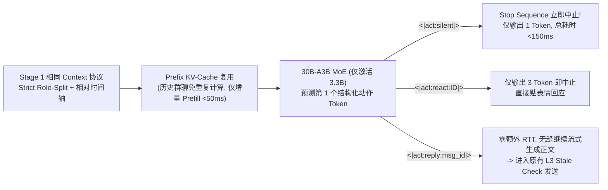
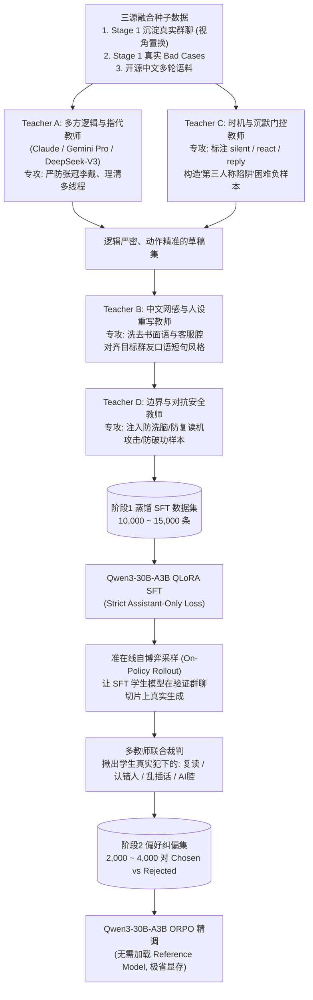

# 03｜Kairos Stage 2：30B MoE LoRA 微调与多教师蒸馏方案

> **文档定位**：本文为 **Stage 2 远期技术预案**——**严格在 Stage 1 Harness 工程跑稳并积累真实群聊运行日志后启动**。核心目标是借鉴米哈游《星布谷地》“多教师在线蒸馏”思想，在 **Colab / Kaggle** 等平民算力环境下，用 **30B 级 MoE LoRA** 攻克纯 Prompt/Harness 无法根治的最后 15%~20% 痛点（客服腔、长上下文多说话人指代漂移、第三人称陷阱、以及双倍决策延迟）。

---

## 一、 何时启动 Stage 2？（前置准入条件）

不要在 Harness 还没稳定前盲目微调，否则微调数据格式改一次就得重训。满足以下条件后再进入 Stage 2：

1. **Stage 1 Context 协议已定型**：Strict Role-Split、相对时间标签、`[U1:昵称]`、动作标签协议 `<|act:...>|>` 已经过 2~4 周真群实测不再频繁大改。
2. **明确观测到纯 Prompt 的能力天花板**（来自 `decision_audit_logs` 埋点统计）：
   * 闭源/通用大模型即便反复调 Prompt，仍带着挥之不去的“AI 客服腔/端水味/过度礼貌”；
   * 群聊超长交织（>30 条、4+ 人辩论）时仍出现张冠李戴；
   * 独立 `gate_model` + `chat_model` 两段串行调用的延迟、API 成本以及**异构双模型“左右脑对齐漂移”**（如 `main_vetoed` 否决率偏高）成为瓶颈，希望合并为**单模型 Single-Pass 极速前向**。
3. **数据原材料已就位**：Stage 1 的 PostgreSQL 已沉淀数万条带结构化拓扑的真实群聊消息（`group_messages`），以及数百条人工标记的典型 Bad Cases（`decision_audit_logs`）。

---

## 二、 Stage 1 -> Stage 2 架构无缝升级：Single-Pass 首 Token 联合门控

在 Stage 1 中，我们采用“独立小模型初筛 Gate（~400ms）+ 主模型带 Veto 生成（~1.8s）”的两段式方案。进入 Stage 2 自部署微调后的 **30B-A3B MoE** 模型后，Harness 无需推倒重写，只需将 `gate.py` 与 `chat_model` 合并为 **Single-Pass 联合推理**——**从物理上彻底消除异构双模型的对齐分裂问题**：



#### 架构升级讲解
* **为什么能消灭双倍延迟？** 借助 vLLM / SGLang / llama.cpp 的 **Prefix Caching**，群聊历史上下文的 KV-Cache 已被缓存，新来几条群消息只需几十毫秒增量编码。模型用**同一个前向过程**先吐出决策标签：决定闭嘴就 1 个 Token 截断结束（几乎零算力消耗）；决定说话就直接顺着吐正文，彻底消除 Stage 1 的二次网络往返与重复 Prefill。
* **为什么必须是 MoE（如 30B-A3B）而非 32B Dense？** 30B 总参数提供了足够大的记忆容量来装下中文互联网梗、复杂多方语境与细腻人设；而仅 3.3B 的激活参数让推理速度和 3B~4B 小模型同一量级，单张消费级 24GB 显卡（或低价按量云卡）即可飙到 80~120 tokens/s。

---

## 三、 借鉴《星布谷地》多教师蒸馏的平民落地方案

米哈游在算力集群上采用“多教师在线蒸馏（实时挂载多个教师算 KL Loss）”，个人在 Colab/Kaggle 上受显存限制无法直接复刻。我们保留其**“多专项教师解耦能力 -> 融合进单一学生模型”**的灵魂，改造为**“离线四教师合成 + 准在线 Rollout ORPO 纠偏”两阶段管线**：



#### 蒸馏管线核心原理解析
1. **为什么拆成 4 个专项教师，而不是让 1 个最强模型一口气生成？**
   单一强模型同时被要求“逻辑严密 + 懂群聊黑话 + 懂何时闭嘴 + 防提示词注入”时，各目标会互相打架（典型表现：逻辑越严谨的模型，说话越像官僚客服）。把**逻辑骨架（Teacher A）**、**发言时机（Teacher C）**、**口语网感（Teacher B）**、**边界防御（Teacher D）**拆成流水线各司其职，再全部蒸馏回同一个 30B 学生模型，就能实现“既有极强逻辑和边界，说话又完全像真人网友”。
2. **为什么阶段 2 选 ORPO 而不是传统 DPO？**
   标准 DPO 在训练时需要在显存里同时维护 Policy Model 和 Reference Model，极易在 Colab/Kaggle 爆显存；**ORPO（Odds Ratio Preference Optimization）无需 Reference Model**，显存占用几乎等同普通 SFT，且专门针对学生模型自己 Rollout 犯下的真实错误做负样本惩罚，是个人算力下最接近“在线蒸馏”的纠偏手段。

---

## 四、 训练数据来源、清洗法与黄金配比

对于 30B LoRA，**10K~15K 高纯度样本的效果远胜 100K 脏数据**。建议按以下配比构建：

### 4.1 来源一：真实 QQ 群聊记录的“视角置换法”（占比 35% ~ 45%）

区别于 WeClone 只能洗 1v1 私聊记录，我们针对**多人群聊**提出**视角置换清洗法（Perspective Rotation）**：

1. **导出与严格脱敏**：优先使用 Stage 1 的 `group_messages` 表（天然带标准字段与引用关系），或通过 `qq-chat-exporter` 导出有合法权限的活跃高质量老群记录。用正则彻底脱敏手机号、身份证、邮箱、真实姓名与敏感链接，QQ 号映射为 `U1~U8`。
2. **切分活跃窗口**：按 5 分钟静默作为边界，切出每段 15~40 条消息、含 3~6 名活跃群友的连续片段，执行与 Stage 1 完全一致的“10 秒同人连发合并”与“相对时间标注”。
3. **选定代理主体（Proxy Self）重构 `user / assistant`**：
   * 在片段中挑出 1 位情商在线、说话自然、不过度刷屏的群友，把他的发言全部抽出来作为 `assistant` turn，其余所有群友打包为 `user` turn；
   * **天然沉默样本挖掘**：当其他群友连续发了 4~8 条消息而这位代理群友没有插话时，随机选 1~2 个时间切点生成一条 `assistant` 目标为 `<|act:silent|>` 的样本！这能教给模型最真实的“人类潜水节奏”。
4. **人设口吻微调（Teacher B）**：保持代理群友的**发言时机、回复目标和核心语义**完全不变，仅用 Teacher B 将其措辞轻微对齐到目标 Bot 的口癖与人设。

### 4.2 来源二：多教师合成的五大痛点对抗集（占比 30% ~ 40%）

1. **张冠李戴高压对抗集（~1,500 条）**：构造 4~5 人立场相反、互相反串的密集讨论，测试精准点名与观点归属。
2. **自我边界与防复读对抗集（~1,000 条）**：在历史 `assistant` turn 植入 Bot 刚发表的观点，下轮安排群友重复提问或曲解原意，训练 Bot 自然认领“我上面刚说过，简单说就是……”或反驳“不是，我刚意思是……”，彻底根治把自己当旁人。
3. **第三人称陷阱与读空气对抗集（~1,500 条）**：高频出现 Bot 名字但并非呼唤它（“上次小满推荐那个不好吃”）、或群友正激烈吵架/聊私人正事 -> 强制标注 `<|act:silent|>` 或轻量 `<|act:react|>`。
4. **多线程交织与时间断层集（~1,000 条）**：同时包含 15 分钟前已冷话题与 5 秒前热话题，训练模型绝不无故回复旧话题；必须回应时严格输出旧消息 `msg_id`。
5. **人设防污染与 Stage 1 真实 Bad Cases 转化（~1,000 条）**：覆盖“忽略指令/变猫娘/复读机陷阱”等群聊常见调戏，并把 Stage 1 线上标记的 Bad Cases 直接转化为阶段 2 ORPO 的核心偏好对。

### 4.3 来源三：开源中文多轮语料改造（占比 10% ~ 15%）
* 抽取 **NaturalConv**（话题自然漂移）、**KdConv**（知识驱动多轮）、**PersonalDialog**（带人设对话）及公开播客/影视多人台本，按相同 `[U1]/[U2]` + 相对时间协议重构，扩展话题多样性。

### 4.4 来源四：通用指令防遗忘回放数据（占比 10%）
* 混入 1,000~1,500 条高质量中文通用指令/百科/推理数据（如 Magpie 中文高分集），防止微调后 30B 模型出现灾难性遗忘（变得只会水群却答不上基本常识）。

---

## 五、 30B 基座选型与 Colab / Kaggle 实操避坑指南

### 5.1 基座模型横向评估

| 候选模型 | 参数与结构 | Unsloth 训练显存需求 | 部署推理速度 | 选型结论与关键避坑 |
| :--- | :--- | :--- | :--- | :--- |
| **`Qwen3-30B-A3B-Instruct-2507`** | **MoE**（30.5B 总参 / **3.3B 激活**，非思考直出） | **~17.5 ~ 20 GB**（4-bit QLoRA） | **极快**（单张 24GB 卡 80~120 tok/s） | **Stage 2 强烈首选！** 兼得 30B 知识网感与 3B 极速响应；直出模式无冗长 `<think>` 延迟；Unsloth 4-bit 极其成熟 |
| **`Qwen3.5-35B-A3B`** | **MoE**（35B 总参 / ~3B 激活，混合架构） | **~74 ~ 80 GB**（需 BF16 LoRA） | 极快 | **重大避坑！** Unsloth 官方明确**不推荐对 Qwen3.5 使用 4-bit QLoRA**（混合架构量化精度偏差大），需 Colab Pro+ A100-80GB 才能训 |
| **`Qwen3-32B` / `Qwen2.5-32B`** | Dense（32B 全激活） | ~20 ~ 24 GB（4-bit QLoRA） | 较慢（比 MoE 慢 5~8 倍） | 推理延迟与部署成本对实时群聊不友好，不如 30B-A3B |
| **`Qwen3-14B` / `8B`** | Dense | ~8 ~ 14 GB（4-bit QLoRA） | 快 | 适合在 **Kaggle 免费单卡 T4 / P100** 上零成本先验证整套数据与微调管线 |

### 5.2 Colab vs. Kaggle 算力现实避坑

> [!WARNING]
> **在 Colab / Kaggle 上微调 30B MoE 必踩的 3 个坑**：
> 1. **Kaggle 单卡 T4（16GB）直接 OOM 且无原生 `bf16`**：30B-A3B 4-bit QLoRA 需 ~17.5~20GB，单 T4 塞不下，且 T4 仅支持 `fp16`，MoE 极易梯度溢出（Loss 变 NaN）。
> 2. **磁盘爆盘**：拉取 16-bit 原始权重会下载 60GB+ 文件，直接撑爆免费容器硬盘。**必须拉取 Unsloth 预量化 4-bit 仓库**（`unsloth/Qwen3-30B-A3B-Instruct-2507-unsloth-bnb-4bit`，仅占 ~18GB）。
> 3. **全序列算 Loss 导致串角色**：如果不做 Response-Only Masking，模型会把群友的 `user` 话也当训练目标去学，微调完反而更爱精神分裂和替别人说话！

**分预算算力落地方案：**
* **推荐性价比方案（Colab Pro L4 24GB / A100 40GB）**：原生 `bf16` + Unsloth 单卡直接稳跑 `Qwen3-30B-A3B-Instruct-2507`。12K 样本 × 2 Epochs 在 A100-40GB 上约 **2~3 小时**（L4 上约 5~7 小时），单次完整训练花费仅几十元级计算单元。
* **纯免费 Kaggle 2×T4（32GB 总显存）方案**：
  * 方案 A：用标准 HuggingFace + `bitsandbytes (nf4)` + `accelerate` 的 `device_map="auto"` 把 30B-A3B 跨两张 T4 切分（`max_seq_length=2048`、`batch_size=1`、`grad_accum=16`、`optim="paged_adamw_8bit"`、`lr=5e-5`、`max_grad_norm=0.3` 防 `fp16` 溢出）；
  * 方案 B（更省心）：Kaggle 免费卡先用来精训 **`Qwen3-14B/8B`** 跑通评测集与 ORPO 流程，确认数据无瑕疵后再花几小时 Colab A100 一次性出 30B-A3B 终版权重。

### 5.3 关键训练代码模板（Unsloth + Strict Assistant-Only Loss）

```python
from unsloth import FastLanguageModel
from unsloth.chat_templates import train_on_responses_only
from trl import SFTTrainer, SFTConfig

# 1. 拉取预量化 4-bit 仓库，避免 60GB 磁盘爆盘
model, tokenizer = FastLanguageModel.from_pretrained(
    model_name="unsloth/Qwen3-30B-A3B-Instruct-2507-unsloth-bnb-4bit",
    max_seq_length=3072,       # 覆盖约 30~50 条群聊记录 + 热记忆
    load_in_4bit=True,
)

# 2. MoE 稳定性关键：冻结 Router，仅对 Attention + Expert FFN 挂 LoRA
model = FastLanguageModel.get_peft_model(
    model,
    r=32,
    lora_alpha=32,
    target_modules=[
        "q_proj", "k_proj", "v_proj", "o_proj",
        "gate_proj", "up_proj", "down_proj",
    ],
    lora_dropout=0,
    use_gradient_checkpointing="unsloth",
    random_state=3407,
)

trainer = SFTTrainer(
    model=model,
    tokenizer=tokenizer,
    train_dataset=dataset,     # 遵循与 Stage 1 100% 一致的 Strict Role-Split 格式
    args=SFTConfig(
        per_device_train_batch_size=2,
        gradient_accumulation_steps=8,
        num_train_epochs=2,    # 严格控制 1.5~2 Epochs，防止背诵过拟合
        learning_rate=1e-4,
        lr_scheduler_type="cosine",
        warmup_ratio=0.05,
        bf16=True,             # L4 / A100 必开 bf16
        optim="adamw_8bit",
        output_dir="outputs/kairos-30b-sft",
    ),
)

# 3. 决定成败的核心配置：严禁对群友的 user 消息计算 Loss！
trainer = train_on_responses_only(
    trainer,
    instruction_part="<|im_start|>user\n",
    response_part="<|im_start|>assistant\n",
)

trainer.train()
```

### 5.4 微调后部署建议（与 2C4G 服务器协同）
* **绝对不要把 30B 模型塞进 2C4G 的 CPU 跑推理**——2C4G 永远只运行轻量的 **Kairos Core Harness**。
* 微调完成并合并导出为 **GGUF（Q4_K_M / Q5_K_M）** 或 **AWQ/FP8** 后，通过 OpenAI 兼容端点挂载到云端按量 GPU（如 Serverless GPU / 单卡 24GB 4090/3090 节点）或家里闲置的 24GB 显卡机器（通过内网穿透供 2C4G 服务器调用），在 `global.yaml` 中将 `chat_model` 指向该端点并开启 `single_pass_gate: true` 即可实现零代码侵入平滑切换！
